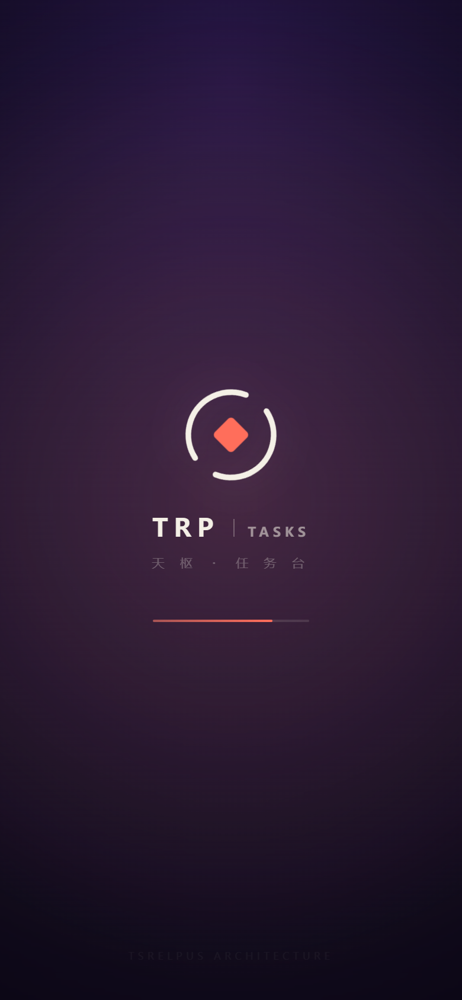
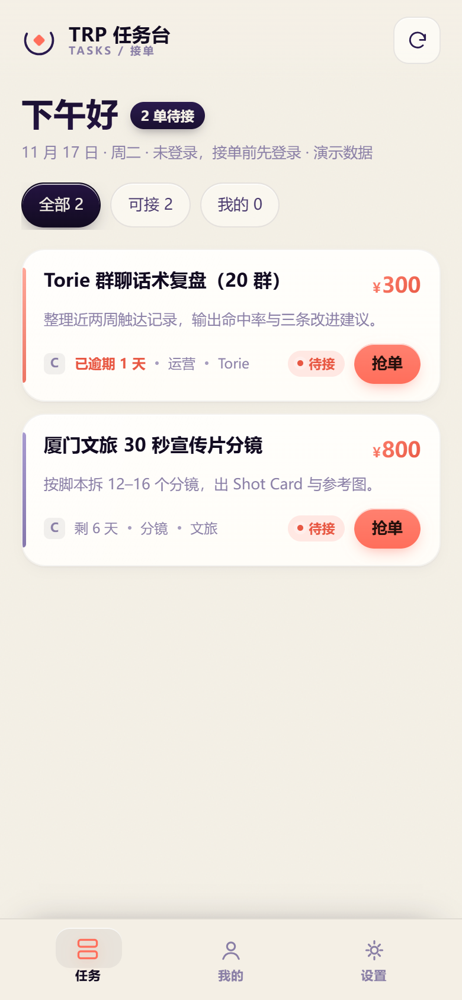
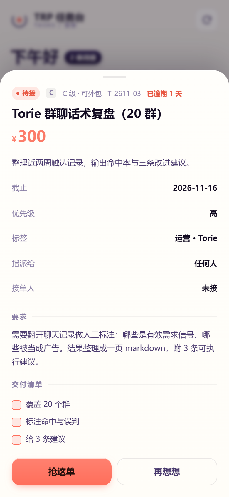
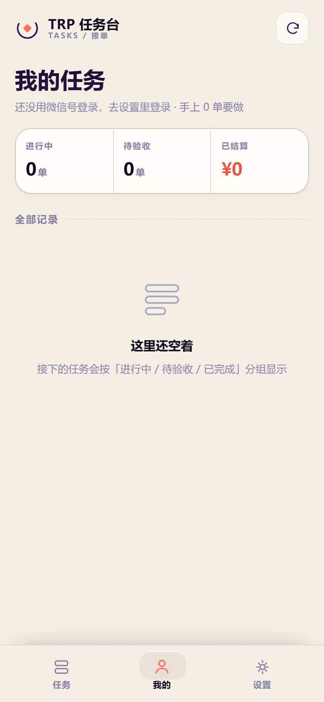

# TRP 任务台 · Android

天枢架构内部接单客户端：**管理员在本机发布或指派任务，手机端只能接单、交付**。
用管理员录入人才库的微信号登录，任务从「待接 → 进行中 → 待验收 → 已完成」流转，
谁接的（微信号）、什么时候接的都写在任务文件里。像滴滴抢单，但发布权只在你手里。

仓库：<https://github.com/Toriesta/trplink.git>

## 视觉与动效

象牙白 `#F4F0E6` 主色、深紫 `#120B21 / #1A1030` 结构、珊瑚 `#FF6E5B` 点缀，
与桌面端 TRP Link 同一套色板，但按移动端的节奏重做了一遍：

- **启动屏**：深紫径向渐变 + 呼吸光晕，轨道标描边自绘、珊瑚方块带过冲弹入、字标逐字上浮、
  珊瑚进度线；1.9 秒结束（点击可跳过），随后主界面淡入上浮接管
- **质感**：极淡噪点叠在象牙白上做出纸感，双层柔光、卡片内高光 + 双层阴影、
  标题与金额用渐变填充、顶栏与底栏玻璃拟态
- **动效**：页面切换淡入上浮、任务卡错时入场（46ms 递进）、tab 指示器弹性滑动、
  数字滚动（rAF + easeOutCubic）、详情抽屉弹簧、按钮 ripple、下拉刷新、空状态呼吸
- **触觉**：抢单 / 提交成功时轻震（Capacitor Haptics，浏览器降级到 `navigator.vibrate`）
- 尊重 `prefers-reduced-motion`：系统关闭动效时，动画与启动屏自动停用

性能约束：动画只动 `transform` / `opacity`，不用大范围模糊；玻璃效果只出现在固定的顶栏与底栏。

<p align="center">
  
  
</p>
<p align="center">
  
  
</p>

## 拿到 APK（推荐：GitHub Actions 免费构建）

1. 把本目录内容推到 `Toriesta/trplink` 的 `main` 分支
2. 打开仓库 **Actions** 页，等 `Android APK` 这一次运行结束（首次约 3–5 分钟）
3. 点进这次运行，在页面底部 **Artifacts** 下载 `trp-tasks-debug-apk`
4. 解压得到 `app-debug.apk`，传到手机点击安装（Android 会提示「允许安装未知来源应用」）

每次 push 都会重新出一个 APK，不需要本地装 Android Studio。

本地也能出包（已装 JDK 17 + Android SDK 34 时）：

```bash
npm ci
npx cap sync android
cd android && ./gradlew assembleDebug      # Windows: gradlew.bat assembleDebug
```

产物：`android/app/build/outputs/apk/debug/app-debug.apk`

## 角色与权限

| 角色 | 在哪 | 能做什么 | 不能做什么 |
| --- | --- | --- | --- |
| 管理员（你） | 本机 `publish_task.py` | 发布任务、指定某人、验收完成 | — |
| 接单人 | 手机 App | 用人才库里的微信号登录、抢单、撤回、提交交付 | 发布任务、自己注册、改别人接的单、把状态改成已完成 |

首次配置管理员（只需一次）：

```bash
python tools/publish_task.py --admin 你的微信号 --set-admin
```

这个值写进 `config.json`，之后任何发布命令都要带同样的 `--admin`，否则脚本直接拒绝。

## 手机端：被动注册 → 登录 → 接单

**手机端不能自己注册。** 管理员先把微信号录入人才库，本人才登录得进去：

```bash
python tools/publish_task.py --admin SimoHoia0523 --add-worker 对方微信号 --worker-name 对方名字 \
  --repo Toriesta/trplink --push
```

未录入的微信号点登录会提示「这个微信号还没录入人才库」。

首次打开默认是**演示数据**（4 条示例任务，只存在手机里）。接真实任务：

1. 打开 App → 底部「设置」→「账号」
2. 输入人才库里已登记的**微信号** → 点「登录」（身份与显示名由人才库同步，不可自行修改）
3. 数据源选 **GitHub 仓库**：owner `Toriesta`，repo `trplink`，分支 `main`，路径 `tasks.json`
4. 填一个 fine-grained PAT（只给这个仓库 `Contents: read and write`）→ 保存并同步
5. 回「任务」页抢单；指派给你的单会显示「指定给你」，并直接出现在「我的」页

公开仓库的**读取不需要 token**；写入需要。token 和微信号都只存手机本地。

现在是临时方案：**微信登录 = 校验人才库里的微信号**，没有微信官方 OAuth（那需要 AppID + 服务器回调）。
将来部署服务器时换成真实微信授权 + 服务端 RBAC，App 侧接口不用改。

### 等级编码：保密等级 + 制作水平

一个编码两个维度：**字母 = 保密等级，数字 0–10 = 制作水平**。
`A5` = 高保密 + 中等制作水平；`B1` = 中等保密 + 低制作水平。

| 字母 | 含义 | 手机端可见性 | 存放位置 |
| --- | --- | --- | --- |
| **A** | 最高机密，必须自己做 | 永远看不到，也不能派单 | 本机 `tasks-private.json`，**不进仓库** |
| **B** | 商业敏感，只给可信成员 | 只有 `trusted` 成员可见可接 | 仓库 `tasks.json` |
| **C** | 常规外包 | 所有已登录成员 | 仓库 `tasks.json` |

| 数字 | 制作水平 | 典型活 | 90 秒参考价 |
| --- | --- | --- | --- |
| 0–2 | 基础 / 流水线经济 | 混剪、套版、加字幕 | 50–90 |
| 3–4 | 偏低 / 标准承制 | 口播、简单包装 | 120–200 |
| 5–6 | 中等 / 短剧进阶 | 分镜级 AI 短片、连载短剧 | 250–400 |
| 7–8 | 较高 / 精品 | 多镜头叙事、角色一致性要求 | 800–1500 |
| 9–10 | 高难 / 参赛旗舰 | 复杂合成、原创视觉风格 | 1500–3000 |

判定方法与档位成本见桌面端 `../README.md` 的「制作水平（craft 0–10）怎么定」：
六维加权（精度 / 叙事 / 一致性 / 声音 / 审核 / 返修），再由档位反推算力成本与可接底线。

规则：

- `--secret` 默认 **A**（安全默认）：不带这个参数只写本机，不会外发
- `--craft` 默认 **5**，超范围会被拒
- 派单时**制作水平必须匹配能力**：人才库里的 `craft_max` 是这个人能做的上限；超了不能抢，管理员指派也会被拦下
- 授予可信身份：`--trust-worker 微信号`；调整能力上限：`--craft-max 7`

## 给客户打分（接单人）

任务里标了客户名（发布时 `--client 客户名`），详情页就会出现「客户评价」：

- **1–5 星** + 标签（钱多 / 事少 / 回款快 / 需求乱 / 拖延 / 返修多）
- 评分写回仓库的 `ratings.json`；同一个人对同一客户只保留最新一票
- 桌面端「客户」页同步后，会把这批评分折算进客户可持续性（占 20%）
- 平均分 ≤2 的客户会被限制在 B 级以下：钱再多也不升档、不让价

没有标客户名的任务不显示评分区，避免把 A 客户的意见记到 B 头上。

## 发布任务（仅管理员）

```bash
# A 级：最高机密，只留本机（默认就是 A，不能指派、不能 push）
python tools/publish_task.py --admin SimoHoia0523 --secret A --title "客户原始素材整理"

# B 级：只给可信成员，可直接指派
python tools/publish_task.py --admin SimoHoia0523 --secret B --title "海外样片" \
  --reward 1500 --assign-to chenchengfang --repo Toriesta/trplink --push

# C 级：任何已登录成员都能抢
python tools/publish_task.py --admin SimoHoia0523 --secret C --title "第 16 集粗剪" \
  --reward 400 --deadline 2026-11-25 --tags "剪辑,ODSUS" --checklist "字幕|音效" \
  --repo Toriesta/trplink --push
```

> LLM 判定与结款的完整设计见 [`docs/dispatch-and-payout.md`](docs/dispatch-and-payout.md)。

指派时会自动把这个微信号写进 `users.json`（工人角色），手机端按微信号找到自己的单。
平时加人用 `--add-worker`，不需要发布任务。

### GitHub 方案的能力边界

GitHub 的 token 是**仓库级**权限，没法在 GitHub 层做到「这个 key 只能接单不能发布」。
所以这里的权限是**应用层**的：手机端没有发布入口，`claim/submitted` 会校验微信号与任务归属，
发布脚本用 `config.json` 的管理员微信号校验。拿到写 token 的人理论上仍可直接改仓库里的 JSON——
这是临时软件的边界，上服务器后由后端角色校验彻底解决。

字段说明：

| 字段 | 含义 |
| --- | --- |
| `id` | 形如 `T-2611-05`，脚本自动生成 |
| `reward` | 金额（人民币） |
| `deadline` | `YYYY-MM-DD`，≤2 天会标珊瑚色 |
| `priority` | 1 高 / 2 中 / 3 低，决定卡片左侧竖条颜色 |
| `secret` | 保密等级 `A` / `B` / `C`（A 不进仓库） |
| `status` | `open` 待接 / `claimed` 进行中 / `submitted` 待验收 / `done` 已完成 |
| `claimedBy` | 接单人**微信号**（App 自动写） |
| `claimedName` | 接单人显示名 |
| `assignedTo` | 指定接单人的微信号；非空时只有此人能接 |
| `checklist` | 交付清单，字符串数组 |

## 一键同步（双击）

改完 `users.json`（人才库）或 `tasks.json`（任务池）后，双击 **`同步到GitHub.bat`** 就行。
它不会无脑 `git add -A`，而是：

1. 校验三个 JSON 的结构（任务等级、成员角色、管理员微信号）
2. **拦截 A 级任务**：A 级只能在本机 `tasks-private.json`，混进共享池直接中止
3. **扫描密钥**：令牌、私钥、明文密码命中就中止，不推
4. 只提交白名单内的文件（`tasks.json` / `users.json` / `config.json` / `www/` / `tools/` / `docs/` / `android/` 等）
5. 提交并推送；网络断了会自动重试 3 次，本地提交不会丢

想先看会提交什么，不实际推：

```bash
python tools/sync_github.py --dry-run
```

## 目录

```text
mobile-app/
├─ www/                       纯原生 HTML/CSS/JS，无前端框架
│  ├─ index.html              页面骨架
│  ├─ styles.css              全套视觉（象牙白 / 深紫 / 珊瑚）
│  ├─ store.js                数据层：本地演示 + GitHub contents API + 缓存
│  └─ app.js                  界面层：三个 tab、详情抽屉、抢单/提交/撤回
├─ android/                   Capacitor 生成的原生壳（含 Gradle wrapper）
├─ tasks.json                 任务池，GitHub 模式直接读它
├─ users.json                 人才库：微信号 / 显示名 / 角色（被动注册白名单）
├─ config.json                管理员微信号（发布脚本校验）
├─ 同步到GitHub.bat           双击同步：校验 → 拦截 A 级 → 扫密钥 → 提交推送
├─ tools/
│  ├─ publish_task.py         命令行发布任务 / 录入人才 / 授权可信（标准库）
│  ├─ sync_github.py          同步逻辑：白名单提交、JSON 校验、安全扫描、推送重试
│  └─ make_icons.py           生成品牌图标与启动屏（Pillow）
├─ .github/workflows/
│  └─ android.yml             push 后自动构建 APK 并上传 Artifact
├─ capacitor.config.json
└─ package.json
```

## 说明

- 用 Capacitor 而不是原生 Kotlin：界面改动只改 Web 文件，不用碰 Activity；同时还能在浏览器里先预览
- 用 GitHub 仓库当后端：不要服务器、不要数据库，免费额度对个人工具足够；写入走 contents API，天然带提交历史
- 多人同时抢同一单时，`tasks.json` 的 sha 会冲突，App 会提示「刷新后再试」，不会静默覆盖别人接的单
- `debug` 包可直接安装；要做正式发行版需另配签名密钥，本仓库不含任何密钥
